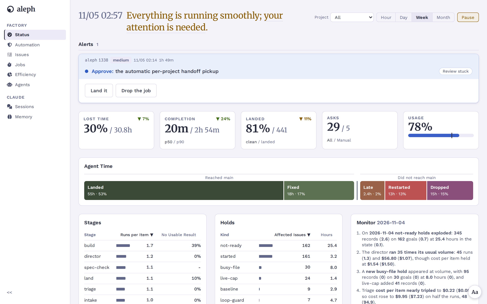

<h1 align="center">aleph</h1>

<p align="center">A Claude Code plugin for one person: memory, guard rails, and a factory that works through the issue list.</p>

<p align="center">
  <a href="https://github.com/crsmithdev/aleph/actions/workflows/ci.yml"></a>
  
  
</p>

<p align="center">
  <picture>
    <source media="(prefers-color-scheme: dark)" srcset="docs/images/status-dark.png">
    
  </picture>
</p>

Aleph loads into each Claude Code session and adds memory, tracing and a few checks. It also runs a factory: it takes an open issue, writes a spec, builds the change in a worktree, tests it, reviews it and lands it on `main`. When it cannot decide something, it asks.

## Features

- **Memory.** Notes live in an Obsidian vault. Each session starts with the core notes, and each prompt gets up to 3 more that fit it. [Vault](docs/vault.md)
- **Verify gate.** Claude cannot say "done" after a code change unless a run after the last edit backs it up. [Verify gate](docs/verify-gate.md)
- **Guards.** No edits on `main` outside a worktree. No commits with a secret or a stray `debugger`. A `gh` write to someone else's repo asks first. [Hooks](docs/hooks.md)
- **Handoffs.** A warning when the context fills up. After a compaction, Claude writes a handoff and the next session picks it up.
- **Tracing.** Each turn is one Langfuse trace, with each tool call, subagent and model call and what it cost. [Langfuse](docs/langfuse.md)
- **Issues.** One list per repo, kept in a private git repo. Only `aleph issue` writes to it. [Issues](docs/issues.md)
- **Factory.** Intake writes a spec with a test that proves it. A worker builds it. Checks and a fresh reviewer decide if it lands. A failure goes back to the worker to fix. [Workflow](docs/workflow.md)
- **Director.** An agent answers the factory's questions when it can, and passes the rest on with a short case. An "Always" button turns an answer into a rule.
- **Model routing.** Small changes go to Haiku or Sonnet, larger ones to Opus. Small tiers can run on a local model instead. [Routing](docs/routing.md)
- **Web UI.** Status, issues, jobs, cost, agents, sessions and memory, in light and dark. [UI](docs/ui.md)
- **Skills.** 23 skills: grill a plan, red-team it, write a spec, test first, debug, review a branch, clean up a repo, write docs, hand off a session. Run one with `/aleph:<name>`.

## Quick start

You need Claude Code 2.1 or later and [Bun](https://bun.sh).

```bash
git clone git@github.com:crsmithdev/aleph.git ~/aleph
cd ~/aleph && bun install
ln -s ~/aleph ~/.claude/skills/aleph                   # Claude Code loads it as aleph@skills-dir
ln -s ~/aleph/identity/CLAUDE.md ~/.claude/CLAUDE.md   # optional: the identity the hooks assume
ln -s ~/aleph/bin/aleph ~/aleph/bin/aleph-ui ~/.local/bin/
```

Start a Claude Code session in any repo, then try:

```bash
/aleph:grill-me move the cache from Redis to SQLite        # in the session

aleph issue add aleph "The Status page shows the wrong weekly usage" --priority high
aleph issue list aleph --status open
aleph-ui --port 3020                                                  # prints the URL
```

Tracing is off until you add Langfuse keys; everything else works without them. To let the factory build a repo, set `"sandbox": true` for it in `~/.aleph/repos.json` and start the timers in [Factory](docs/factory.md).

A change to a `SKILL.md` applies at once. After you change a hook, run `/reload-plugins`. To try a checkout in one session only, run `claude --plugin-dir <path>`.

## Development

```bash
bun run test        # the suite, in parallel, with a mock Langfuse
bun run test:all    # also the slow tests that start Chrome, as CI runs it
bunx tsc            # the type check
ALEPH_LIVE=1 bun test tests/live   # needs a running Langfuse and a logged-in claude
```

CI runs the type check and the suite on each push. Only the live tests prove that Langfuse kept a trace: a 200 from Langfuse does not.

## Docs

- [Overview](docs/overview.md): what aleph is, its parts and its terms
- [Architecture](docs/architecture.md): the processes, folders and main flows
- [Workflow](docs/workflow.md): how an issue gets to `main`, and where it can stop or go back
- [Data model](docs/data-model.md): each file and store under `~/.aleph`
- [Hooks](docs/hooks.md): each hook and what it allows or blocks
- [Routing](docs/routing.md): which model does each job
- [Factory](docs/factory.md): set-up, commands and settings
- [Issues](docs/issues.md): the issue store and `aleph issue`
- [Vault](docs/vault.md): the memory vault and its commands
- [UI](docs/ui.md): run and extend `aleph-ui`
- [Langfuse](docs/langfuse.md): set up tracing
