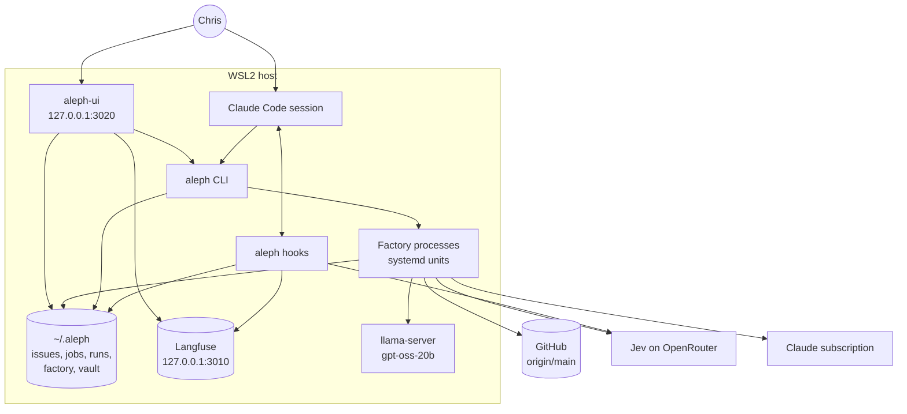

# Architecture

## System context

Chris works in Claude Code sessions and on the UI. Both write through the `aleph` CLI. The factory reads and writes the stores, starts `claude -p` runs and pushes to GitHub. Nothing listens on a public interface.

## Processes

| Process | Started by | Lives | Code |
|---|---|---|---|
| Hooks | Claude Code, per event | One event | `hooks/*.ts` |
| `aleph` CLI | Chris, a session, the UI | One command | `jobs/cli.ts` |
| `aleph tick` | `aleph-tick.timer`, each minute | Seconds | `jobs/lib/tick.ts` |
| `aleph suite` | `aleph-suite.timer`, hourly | Minutes | `jobs/lib/factory.ts` `suiteStep` |
| Dispatch, intake, director | A transition, as a transient systemd unit | Until done | `jobs/lib/launch.ts` |
| Unit: worker, verify, review, land | A dispatch | Up to the time boxes | `jobs/lib/unit.ts` |
| `aleph-ui` | `aleph-ui.service` | Always | `ui/server.ts` |
| `llama-server` | `aleph-gpt-oss.service` | Always, optional | `jobs/lib/gpt-oss-start.ts` |

The unit files are in `jobs/systemd/`. [Start at boot](start-at-boot.md) starts WSL and the units after a Windows restart.

## Building blocks

| Folder | Holds |
|---|---|
| `hooks/` | One script per hook; `hooks/lib/` has the judge, Jev, OTLP, the secret rules and the snapshots |
| `skills/` | One folder per skill with its `SKILL.md`; the licences of adapted skills |
| `vault/` | `vault/cli.ts` and `vault/lib/`: notes, frontmatter, the FTS index, git |
| `issues/` | The work store client: `issues/lib/store.ts` (git I/O), `todo.ts` (file format), `issues.ts` (the `aleph issue` verbs) |
| `jobs/` | `jobs/cli.ts` and `jobs/lib/`: the factory; `jobs/systemd/` and `jobs/windows/` start it |
| `ui/` | `ui/server.ts`; `ui/api/*.ts` routes, loaded by file name; `ui/views/*.js` pages; `ui/state.ts` builds the Status state in a worker thread |
| `identity/` | The global `CLAUDE.md` and `STYLE.md` |
| `compose/` | Langfuse in Docker |
| `tests/` | Repo-wide tests, `tests/live/` against real services |
| `vendor/` | The upstream text of the adapted skills, for diffs |

The main modules of `jobs/lib/`:

| Concern | Modules |
|---|---|
| Records and runs | `record.ts`, `ledger.ts`, `job.ts`, `run-files.ts`, `outcome.ts`, `stage.ts` |
| Transitions | `transitions.ts`, `continuation.ts`, `factory.ts`, `tick.ts`, `launch.ts` |
| Agent roles | `agent-run.ts`, `agent-call.ts`, `intake.ts`, `unit.ts`, `director.ts`, `monitor.ts`, `title.ts` |
| Gates and checks | `goal-decision.ts`, `factory-status.ts`, `checks.ts`, `keep-earn.ts`, `gate.ts`, `worker-verdict.ts` |
| Land and recovery | `landing.ts`, `rescue.ts`, `firefighter.ts`, `doctor.ts` |
| Routing | `route.ts`, `models.ts`, `gpt-oss-start.ts` |
| Asks | `ask.ts`, `director.ts` |
| Learning | `corrections.ts`, `episode.ts`, `monitor-table.ts` |
| Infrastructure | `git.ts`, `process.ts`, `clock.ts`, `settings.ts`, `layout.ts`, `main-clone.ts` |

## Key flows

### A session turn

1. `SessionStart`: `vault-context` injects memory, `handoff-start` offers a handoff, `aleph report --hook` injects the factory report.
2. `UserPromptSubmit`: `verify-gate` snapshots the repo; `vault-recall` injects notes.
3. `PreToolUse`: `git-guard`, `secret-scan` and `gh-guard` allow, deny or ask.
4. `Stop`: `verify-gate` compares against the snapshot and may block; `context-gate` may warn or ask for a handoff.
5. Every event: `obs.ts` adds a span to the turn's trace.

[Hooks](hooks.md) has each step.

### An issue to main

`aleph issue add` writes the store and starts intake. Intake writes the spec and starts a dispatch. The dispatch asks the gates and starts a unit. The unit runs the worker, Verify and the reviewer, then lands. Each run's end starts the next dispatch. [Workflow](workflow.md) has each step, gate and send-back.

### The UI read path

`GET /api/state` sends the build to a worker thread (`ui/state-load.ts`, `ui/state-worker.ts`). `ui/state.ts` reads the job records, the factory directory and the work store, and writes nothing. Other `ui/api/*.ts` routes read Langfuse for sessions and skills. Every POST runs an `aleph` command in its own process (`ui/cli.ts` `runCli`), so the UI and the CLI have one write path.

## Invariants

- **One writer per store.** `aleph issue` writes the work store; `git-guard` denies a direct edit. `vault/cli.ts` writes the vault. `record.ts` is the only module that opens a job record.
- **Work happens in worktrees.** No edit lands on a main checkout. A worker cannot push; only the land pushes.
- **The record is on `origin/main`.** The work store reads and writes `origin/main`. An issue is done when a commit on main names it in an `Issue:` trailer.
- **Transitions start the next step.** No step waits for the tick. The tick's sweep reports a missed transition as a bug.
- **A check with no verdict is not a failure.** A time-out or a kill is `infra`, and the rescue checks again.
- **Agents cannot widen their own power.** Code checks each director action. Security paths and `bun.lock` always wait for Chris.

## Cross-cutting concerns

| Concern | How |
|---|---|
| Locks | Directories under `$XDG_RUNTIME_DIR/aleph/` with an owner pid; a reboot clears them |
| Load | A check, a worker and a land start only under `ALEPH_LOAD_LIMIT` |
| Clocks | `jobs/lib/clock.ts`; `tests/clock-lint.test.ts` denies a raw `Date.now()` outside the listed files |
| Cost | Each run records its cost; the Efficiency page and the monitor read it |
| Secrets | `~/.aleph/.env`, read by `hooks/lib/env.ts`; `secret-scan` denies a commit that adds one |
| Tests | `bun run test` in parallel; each test makes its own temp stores through the `ALEPH_*` path variables |
| Flakes | A failing check reruns once; a pass on the rerun goes to `flaky.json` and the flake tracker |
