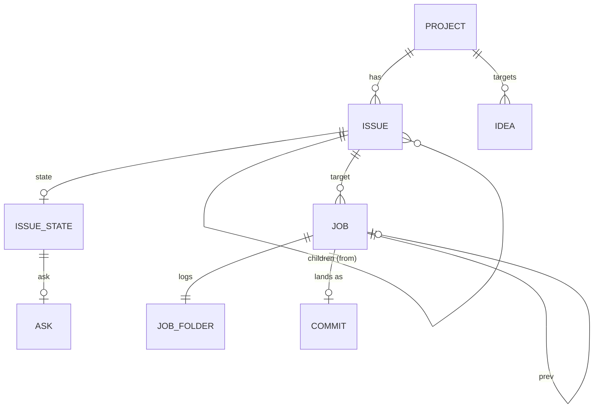

# Data model

Aleph keeps its state in files under `~/.aleph/`: JSON, append-only logs, markdown with frontmatter, and two git repos. `aleph.db`, a SQLite file, holds the counters, the job rows, the events, the issue state, the tick state, the settings, the factory state rows and the usage, suite and flaky logs. The vault keeps a search index of its own. `lib/paths.ts` resolves home, `~` and each path under `~/.aleph`; `lib/layout.ts` and `jobs/lib/infra/settings.ts` read it. An environment variable moves each store for tests.

```text
~/.aleph/
├── items/              projects, issues and ideas: a git repo ALEPH_ITEMS
├── jobs/               job folders: prompts, logs, results    ALEPH_JOBS_DIR
├── factory/            factory settings, baseline, logs       ALEPH_FACTORY_DIR
├── vault/              memory vault: a git repo of notes      ALEPH_VAULT
├── handoffs/           session handoffs                       ALEPH_HANDOFFS_DIR
├── spool/              hand-offs between hooks, 1 day         ALEPH_SPOOL
├── aleph.db            SQLite: counters, jobs, events, issue state, settings, logs  ALEPH_DB
└── .env                keys: Langfuse, OpenRouter, UI password
```

Retention: each tick (`jobs/lib/infra/retention.ts`) deletes data over 90 days old: the folder of a job that ended that long ago (its row stays), a job folder that no row holds and that did not change for 90 days, `usage` rows by `time`, and `dispatch.<day>.log` files (`dispatch.log` moves aside each UTC day under the day it began, which `dispatch.day` holds). The event log and the job rows stay forever.

Locks are not on disk. Each is a directory with an `owner` pid under `$XDG_RUNTIME_DIR/aleph/<name>`, so a reboot clears them (`jobs/lib/infra/locks.ts`).

## Entities



| Entity | Lives in | One per |
|---|---|---|
| Project | `items/projects/<n>/project.md` | Registered repo; its `code` gives the short IDs in [Naming](naming.md) |
| Issue | `items/issues/<n>/issue.md` | Request |
| Sub-issue | `items/issues/<n>/issue.md` with `from` | Issue that intake split from a parent issue |
| Idea | `items/ideas/<n>/idea.md` | Idea; its lens results are files beside it |
| Job | A row of the `jobs` table of `aleph.db`, key `job.<n>` | One execution: build, review, land, recheck, intake, director, monitor, lens, housekeeper, maintainer or plain. A work is a `prev` chain of jobs |
| Job folder | `jobs/<n>/` | The files of a job |
| Issue state | A row of `issue_state` | The Ask, the wait and the CI result of an issue |
| Ask | `issue_state.ask` (`ask_job` names the job that holds it) | Decision that waits |

## Registry: `items/projects/`

One file per project: `projects/<n>/project.md`. The path is the key, `project.<n>`. The frontmatter holds the fields below and the body is the project's description. `loadRegistry` in `jobs/lib/records/ledger.ts` reads the files from the items checkout; a project with no `path` is not a repo and is left out. A write of an issue for an unknown project makes its file (`writeList` in `issues/lib/store.ts`).

| Key | Default | Meaning |
|---|---|---|
| `name` | | The project's name, such as `aleph` |
| `code` | | The short code of the shown ID (`a-01057`) |
| `path` | | The repo's main checkout |
| `env` | | An EnvironmentFile for checks |
| `main` | `"main"` | The main branch |
| `setup` | `[]` | Commands to run before the checks |
| `checks` | `[]` | `{name, run, when?, tests?}`; `tests` globs let a land run only related tests |
| `sandbox` | `false` | A factory repo: the factory builds its issues |
| `autoland` | `true` | A passed run lands by itself |
| `held` | `[]` | Globs whose change waits as a `held-path` Ask |
| `critical` | `[]` | Test globs that every land runs |
| `author` | `false` | Intake also takes in issues filed with a spec |
| `manual` | `[]` | `{when, say}` manual checks |
| `note` | | A line for the project's page |

## Items repo: `items/`

A private git repo. Its `origin/main` is the record. A read fetches and reads through `git cat-file`. A write is one commit made with `commit-tree`, pushed to `origin/main` with up to 5 retries, then the checkout fast-forwards (`issues/lib/store.ts`). `aleph issue` and `aleph idea` are the only writers, and `git-guard` denies an Edit or Write in the repo.

The numbers of issues, projects and ideas come from one counter for each kind in `aleph.db` (`next` in `lib/db.ts`). A write takes its number before the push, so a refused push leaves a gap. The floor of the issue counter is the highest `items/issues/<n>/`.

### Issue file

```markdown
---
project: project.1
title: Ignore future usage rows
kind: bug
priority: high
source: chris
created: 2026-11-04T15:30:00.000Z
---

# Request

The Status page shows the wrong weekly usage.

# Spec

## Goal

## Edit surface

## Oracle

# Notes

- 2026-11-04T10:12:00.000Z: Reproduced on main at c26c10f
```

`issues/lib/todo.ts` (`parseItem`, `renderItem`) owns the format. Notes are append-only: two writers each add a line, and neither erases the other's.

| Field | Values | Meaning |
|---|---|---|
| `project` | `project.<n>` | The project that owns the issue |
| `title` | | An imperative of at most 60 characters |
| `kind` | `task`, `bug`, `check`, `flake`, `proposal`, `acceptance` | `flake` becomes a tracker note at intake |
| `priority` | `low`, `medium`, `high`, `critical` | Dispatch order; none ranks as `medium` |
| `source` | `chris`, `worker`, `memory`, `agent`, `deps` | Who filed it; the director cannot close Chris's |
| `areas` | list | Labels |
| `from` | `issue.<n>` | The parent: intake split this issue from it |
| `after` | list of keys | The issues that must be done first, as `issue.<n>` |
| `refs` | list of keys | Plain references to other issues, as `issue.<n>`, in any project. They hold nothing. An issue's "Referenced by" is derived from the other issues' `refs` and is not stored |
| `media` | list of names | The attached images and PDFs, in `items/issues/<n>/` beside `issue.md` ([Media](issues.md#media)) |
| `parked` | `"true"` | Stops all work on the issue |
| `closed_as`, `closed_at`, `closed_why` | `done`, `dropped`; ISO 8601 UTC; the reason | How, when and why it closed |
| `plan` | `"true"` | Intake will split it |
| `intake` | `build` | Intake took it in |
| `tracker` | `"true"` | The repo's flake tracker |
| `since` | sha | Main's head when the issue was reopened |
| `created` | ISO 8601 UTC, ending in `Z` | When it was made. There is no `updated` field: the update time is the latest of `created`, `closed_at` and the last note. `aleph issue lint --fix` renames the old `created_time` |

The status comes from the fields: `closed_as`, else `parked`, else `open`. `aleph issue lint` flags retired fields.

An issue's children are the issues whose `from` names it (`partsOf` in `issues/lib/store.ts`). The factory does not build a parent. A parent closes as done when each child is done or dropped and at least one is done.

## Job rows and issue state: `aleph.db`

`jobs/lib/records/record.ts` is the only module that reads or writes a job row or an issue state row. `makeJob` creates a row; `setState` and `endRun` write its state, and `endRun` writes the state, the end and `next` in one transaction; each logs the state as an event in the same transaction. The columns hold what every job has: `id` (`job.<n>`), `role`, `by`, `state`, `project`, `made`, `started`, `ended`, `model`, `tier`, `cost`, `commit_sha`, `pid`, `exit_code`, `target`, `prev`, `retry_of`, `was`. Every other field of a `Run` is the JSON `extra` column. The files of a job are in its folder, see below.

A work is a `prev` chain of jobs. `rounds` and `cost` are queries over the jobs of one target, not stored.

`issue_state` has one row for a key while an Ask, a wait or a CI result is live, and no row otherwise. The key is an issue key, or the job key of a run on no issue.

| Column | Holds |
|---|---|
| `issue` | The key |
| `ask` | The open Ask, as JSON |
| `ask_job` | The job that holds the Ask; empty when the Ask is on the issue |
| `wait_kind`, `wait_reason`, `wait_since` | Why the issue does not start |
| `ci` | A CI failure that filed the issue, as JSON: `{url, commit, failure, landed?}` |

A change of the Ask logs `question` or `answered` on the key. The other events (holds, starts, reruns, rescues, director steps) are rows of `events`; [Observability](observability.md) lists them.

### Run

`Run` in `jobs/lib/records/ledger.ts`: the fields of a job row and its `extra`.

| Group | Fields |
|---|---|
| Identity | `id` (`job.<n>`), `role`, `name`, `repo` (the `project` column), `target` (`issue.<n>`), `prev`, `retryOf`, `by`, `branch`, `worktree` |
| State | `state`, `phase`, `reason`, `question`, `next`, `round`, `failed` |
| Why it stopped | `cause`, `checkName`, `fate` |
| Model | `session`, `model`, `tier`, `cost` |
| Checks | `checks[]`, `checkedBase`, `checkedTip` |
| Land | `land`, `merge`, `conflicts`, `commit`, `held`, `stat`, `lander` |
| Worker output | `defaults`, `followups`, `alreadyMet` |
| Report | `shown`, `told` |
| Times | `started`, `ended`, `made` (orders the land queue) |

| Field | Values |
|---|---|
| `role` | `build`, `plain`, `land`, `review`, `intake`, `recheck`, `director`, `monitor`, `lens`, `housekeeper`, `maintainer` |
| `state` | `running`, `waiting`, `passed`, `returned`, `failed`, `landed`, `dropped`, `done` |
| `cause` (`outcome.ts`) | `no-commit`, `timeout`, `stalled`, `infra`, `locked`, `credit`, `check`, `conflict`, `moved`, `review`, `unanswered`, `other` |
| `fate` | `duplicate`, `met`, `manual` |
| `checks[]` | `{name, ok, seconds, tests?: {ran, passed, failed, skipped, failures[]}, rerun?, noVerdict?}` |

A job is open while its latest run is `running`, `passed`, `waiting`, `returned` or `failed`.

## Job folders: `jobs/`

One folder per job: `jobs/<n>/` for the key `job.<n>`. `runFile` in `jobs/lib/records/run-files.ts` names every file.

| File | Holds |
|---|---|
| `spec.md` | The issue's spec, in the folder of the work's first job |
| `prompt.md` | What the agent was given |
| `transcript.jsonl` | The agent's stream-json |
| `result.md` | The agent's final text (a reviewer's verdict text, in its own job) |
| `log.txt` | Sections, each started by a line `=== <name> ===`: `command` (what started the job), `setup`, `stderr`, `dispatch` (the dispatch after the job, and a refused next step), `checks` (Verify's output), `land` |
| `review.json` | The reviewer's verdict, in the reviewer job's folder |
| `batch.json` | The land's batch verdict |
| `pid`, `exit` | The process; the row copies them when the job ends |
| `notes/` | Fix-round notes and follow-up specs, one numbered file each |
| `paused-next` | A next step that a pause kept |

The reviewer is a job of its own (`role review`, `prev` the build). It runs inside the build's unit and has no `pid`.


## Asks

`jobs/lib/asks/ask.ts`. An Ask sits in `issue_state.ask`.

| Field | Holds |
|---|---|
| `kind` | `input` or `approval` |
| `reason` | One of the reasons in [Workflow](workflow.md#8-asks-the-director-and-always-rules) |
| `question`, `options[]`, `recommended`, `why[]` | What intake or code asks; 2 to 4 options |
| `headline`, `situation`, `effects[]`, `recommend` | The director's case text when it escalates |

## Machine state tables: `aleph.db`

`PRAGMA user_version` is 3. Version 2 added `state`, `usage`, `openrouter`, `jev`, `suite_history` and `flaky` to the tables of version 1, and version 3 added `events.tier` (`SCHEMAS` in `lib/db.ts`). A file at version 1 runs only the entries after it when a process opens it.

| Table | Holds | Writer |
|---|---|---|
| `tick` | One row per step: `step`, `last` (the time it last ran) and `result` (`ok`, a short summary or `failed: <error>`). The periodic steps `ci`, `episodes` and `firefight` keep their due time in `last`. Each suite (`suite <repo>`) and the monitor have a row | Tick and every step |
| `settings` | Rows `caps` (`{live?, run?, intakeTries?, jobSeconds?, fixRounds?, landBatch?, loadLimit?}`; an env var wins), `models` (`{<tier>: {enabled, model}}`), `always` (`{<reason>: {action, at}}`), `timeouts` (`{<reason>: {minutes, then}}`; `then` is `pick` or `drop`; a bare number is minutes with `pick`), `paused` (the time of the pause, `null` when resumed) and `judge` (`jev` or `haiku`). Value is JSON | Automation page, Gates page, `aleph pause`, `aleph models`, `aleph always`, `aleph judge` |
| `state` | Rows `baseline` (`{<repo>: {commit, ok, failed?}}`), `ci` (GitHub CI state per repo), `stalls` (stall first-seen times), `smoke` (failures in a row), `backend-hold`, `reran` (CI runs rerun), `recheck-held`, `housekeeper`, `corrections` (signals and lessons), `tick.missed` and `tick.suite`. Value is JSON | Tick, suite, firefighter, housekeeper, corrections |
| `usage` | `seq`, `time`, `five_hour`, `seven_day`, `seven_day_resets_at`: one row per 10 minutes; `pollOnce` writes `time`, `seven_day` and `seven_day_resets_at`, and `five_hour` stays `null` on new rows (only old rows have it) | `pollOnce` in `ui/usage.ts` |
| `openrouter` | `seq`, `time`, `usage`, `factor`: the key's lifetime USD and the rate per list dollar | `pollOpenRouter` in `ui/usage.ts` |
| `jev` | `seq`, `time`, `cost`: one row per Jev call | `decide` in `lib/jev.ts` |
| `suite_history` | `seq`, `time`, `repo`, `commit_sha`, `ran`, `passed`, `failed`, `skipped`, `rerun_passed`: one row per suite run | `aleph suite` |
| `flaky` | `seq`, `time`, `repo`, `check_name`, `run`, `tests` (a JSON array or null): a check that passed on the rerun | Checks |

## Factory directory: `factory/`

| File | Holds | Writer |
|---|---|---|
| `baseline/<repo>/` | The suite's `checks.log` | `aleph suite` |
| `monitor/<day>.json` | The day's table and findings | Monitor |
| `episodes/` | One page per finished issue; kept 90 days | Episodes |
| `episode-use.jsonl` | `{date, title, event, session, query?}` per line; `event` is `shown` or `opened`; kept 90 days | `aleph memory recall --episodes`, the `episode-open.ts` hook |
| `standing-retry/` | Runs an Always `retry` started | Intake |
| `ui-sessions.json` | UI login tokens | `aleph-ui` |
| `dispatch.log` | Output of detached dispatch, intake, director and suite | `launch.ts` |

### Corrections

The `corrections` row of `state` holds `{minedAt, lessons[]}` (`jobs/lib/learning/corrections.ts`). A **signal** is a quote from the last 14 days: Chris in a trace, a verify-gate deny, or a drop reason. A **lesson** groups signals under one sentence, with state `open`, `proposed`, `approved` or `declined`. At 3 signals (`ALEPH_PROPOSE_AT`) a lesson becomes a `proposal-*` Ask; an approved one files an issue.

## Migration: `aleph migrate`

`aleph migrate storage` moves the old store (`issues/`, `ideas/`, `runs/`, the record files in `jobs/` and `jobs-archive/`, `repos.json`, the day files of the event log, the factory JSON files and the usage logs) to the layout above. It finds every path from `ALEPH_DB` (the root) and the `lib/layout.ts` variables, so it runs on a copy. Pause the factory first.

| Step | What it does |
|---|---|
| `--dry-run` | Reads and writes nothing. It prints the counts for each kind, the rows it drops, and each key it has no rule for. |
| Refuse | The real run stops while one key has no rule, or when `aleph.db` already holds jobs, or when an old checkout has changes. |
| Back up | One `backups/storage-<date>.tgz` of the root without `vault/`, `prior-art/` and `backups/`. `gzip -t` reads it back. |
| Convert | One transaction fills `aleph.db`. Job folders are hard links of the old run files, with `log.txt` built from the old logs. The old `issues/` folder becomes `items/` in three commits: the restructure, the merge of the ideas repo and the idea numbers. |
| Check | The rows are compared with the old files that are still in place: the counts, the fields of each run, the event log line by line, and the state files. |
| Push | The items repo goes to its origin. The run prints whether `origin/main` equals `HEAD`. |

`aleph migrate cleanup` deletes what the migration replaced: the old record, run and log files, `*.bak` files, `tick.converted` and `words-migrated`. It refuses until a migration has passed its check.

## Vault: `vault/`

An Obsidian vault in its own git repo, pushed on each commit. `vault/lib/` owns it; [Vault](vault.md) has the commands.

| Path | Holds |
|---|---|
| `wiki/{decisions,concepts,entities,projects,gotchas}/` | Notes, one claim each |
| `daily/<date>.md` | One line per write |
| `archive/` | Notes out of the index |
| `MEMORY.md` | Standing context, at most 150 lines |
| `Home.md` | Generated index |
| `VAULT.md` | Chris's contract; the agent never edits it |
| `.index/vault.sqlite` | FTS5 search index, git-ignored |
| `.index/seen/<session>.json` | Notes recall already showed, kept 7 days |
| `.index/runs/<name>.json` | The newest run of one vault process (`seen prune`, `recall trim`, `vault push`) as `{at, result, detail?}`; `result` is `ok` or `failed` |

Note frontmatter: `kind`, `scope` (a repo or `global`), `confidence` (`measured`, `reported`, `inferred`), `updated`, `supersedes`, `sources`, and optionally `aliases`, `tags`, `core` (one line of at most 160 characters for the start context). A note decays after a number of days by kind: project 30, gotcha 60, decision 180, concept and entity 365.

## Handoffs: `handoffs/`

`projects/<repo>.md` is the handoff for a repo; its first line is `summary:`. The `handoff` skill writes it, `handoff-start` offers it at the next session start, and `pickup` moves it to `<YYYY-MM-DD-HHMMSS>-<repo>.md`.

## Traces: Langfuse

Langfuse is outside `~/.aleph`, at `http://127.0.0.1:3010`.

| Trace | Id | Session | Writer |
|---|---|---|---|
| A Claude Code turn | `sha256("turn:" + prompt_id)` | The Claude session | `hooks/obs.ts` |
| A factory run | `traceIdFor(runId)`, named `factory <name>` | The run's job | `jobs/lib/learning/trace.ts` |

A turn trace holds a root `turn` span, one generation per model call with usage and cost, and one span per tool, subagent and event. Scores: `rating`, `verified`. [Langfuse](langfuse.md) has the setup.
