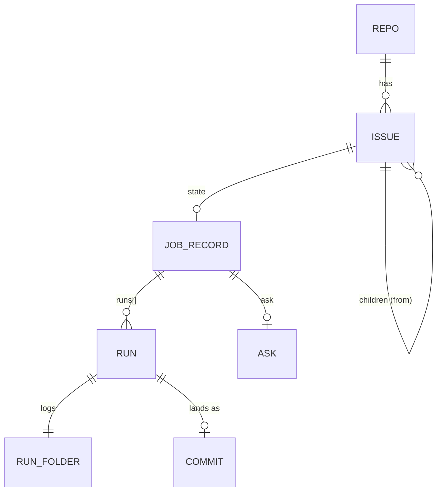

# Data model

Aleph keeps its state in files under `~/.aleph/`: JSON, append-only logs, markdown with frontmatter, and two git repos. The only database is the vault's search index. `jobs/lib/infra/layout.ts` and `jobs/lib/infra/settings.ts` resolve each path; an environment variable moves each store for tests.

```text
~/.aleph/
├── repos.json          registry of repos                      ALEPH_REPOS
├── issues/             work store: a git repo of issues       ALEPH_ISSUES
├── jobs/               job records: the run state             ALEPH_RECORDS_DIR
├── runs/               run folders: prompts, logs, results    ALEPH_JOBS_DIR
├── factory/            factory settings, baseline, logs       ALEPH_FACTORY_DIR
├── vault/              memory vault: a git repo of notes      ALEPH_VAULT
├── handoffs/           session handoffs                       ALEPH_HANDOFFS_DIR
├── spool/              hand-offs between hooks, 1 day         ALEPH_SPOOL
├── usage.jsonl         plan usage, each 10 minutes
├── judge               jev or haiku
└── .env                keys: Langfuse, OpenRouter, UI password
```

Locks are not on disk. Each is a directory with an `owner` pid under `$XDG_RUNTIME_DIR/aleph/<name>`, so a reboot clears them (`ledger.ts` `lock`).

## Entities



| Entity | Lives in | One per |
|---|---|---|
| Repo | `repos.json` | Registered repo; its `code` gives the short IDs in [Naming](naming.md) |
| Issue | `issues/<repo>/backlog/tasks/<repo>-<n>.md` | Request |
| Sub-issue | `issues/<repo>/backlog/tasks/<repo>-<n>.md` with `from` | Issue that intake split from a parent issue |
| Old part | `issues/<repo>/backlog/tasks/<repo>-<n>.<k>.md` | Sub-issue from before `from`; intake no longer makes one |
| Job record | `jobs/<repo>-<n>[.<k>].json` | Issue or sub-issue with work on it |
| Run | An entry in the job record's `runs[]` | Agent process: intake, worker, land, director, … |
| Run folder | `runs/<stamp>-<subject>-<n>/` (old: `runs/<stamp>-<name>-<kind>/`) | Run |
| Ask | The job record's `ask` | Decision that waits |

## Registry: `repos.json`

An object keyed by repo key. `loadRegistry` in `jobs/lib/records/ledger.ts` reads it; no code writes it.

| Key | Default | Meaning |
|---|---|---|
| `path` | | The repo's main checkout |
| `env` | | An EnvironmentFile for checks |
| `main` | `"main"` | The main branch |
| `setup` | `[]` | Commands to run before the checks |
| `checks` | `[]` | `{name, run, when?, tests?}`; `tests` globs let a land run only related tests |
| `sandbox` | `false` | A factory repo: the factory builds its issues |
| `autoland` | `true` | A passed run lands by itself |
| `held` | `[]` | Globs whose change waits as a `held-path` Ask |
| `critical` | `[]` | Test globs that every land runs |
| `author` | `false` | Intake also takes in issues filed with a spec |
| `manual` | `[]` | `{when, say}` manual checks |

## Work store: `issues/`

A private git repo. Its `origin/main` is the record. A read fetches and reads through `git cat-file`. A write is one commit made with `commit-tree`, pushed to `origin/main` with up to 5 retries, then the checkout fast-forwards (`issues/lib/store.ts`). `aleph issue` is the only writer, and `git-guard` denies an Edit or Write in the store.

Each `<repo>/` folder is a [Backlog.md](https://github.com/MrLesk/Backlog.md) project. `<repo>/backlog/floor.json` holds `{next, parts}`, the highest numbers that work outside the list has used.

### Issue file

```markdown
---
id: aleph-1057
title: Ignore future usage rows
created_time: 2026-11-04T15:30:00.000Z
priority: high
kind: bug
source: chris
---
<!-- request -->
The Status page shows the wrong weekly usage.
<!-- spec -->
## Goal
## Edit surface
## Oracle
<!-- notes -->
- 2026-11-04T10:12:00.000Z: Reproduced on main at c26c10f
```

`issues/lib/todo.ts` (`parseItem`, `renderItem`) owns the format. Notes are append-only: two writers each add a line, and neither erases the other's.

| Field | Values | Meaning |
|---|---|---|
| `id` | `<repo>-<n>`, `<repo>-<n>.<k>` | The number; a finished issue keeps it |
| `title` | | An imperative of at most 60 characters |
| `kind` | `task`, `bug`, `check`, `flake`, `proposal`, `acceptance` | `flake` becomes a tracker note at intake |
| `priority` | `low`, `medium`, `high`, `critical` | Dispatch order; none ranks as `medium` |
| `source` | `chris`, `worker`, `memory`, `agent`, `deps` | Who filed it; the director cannot close Chris's |
| `areas` | list | Labels |
| `from` | `<repo>-<n>` | The parent: intake split this issue from it |
| `after` | list of ids | The issues that must be done first |
| `media` | list of names | The attached images and PDFs, in `<repo>/backlog/media/<repo>-<id>/` ([Media](issues.md#media)) |
| `parked` | `"true"` | Stops all work on the issue |
| `closed_as`, `closed_time`, `closed_why` | `done`, `dropped` | How it closed |
| `plan` | `"true"` | Intake will split it |
| `intake` | `build` | Intake took it in |
| `tracker` | `"true"` | The repo's flake tracker |
| `since` | sha | Main's head when the issue was reopened |
| `created_time`, `updated_time`, `closed_time` | ISO 8601 UTC, ending in `Z` | When it was made, last changed and closed. `aleph issue lint --fix` converts the old `created`, `updated` and `closed_at` dates |

The status comes from the fields: `closed_as`, else `parked`, else `open`. `aleph issue lint` flags retired fields.

An issue's children are the issues whose `from` names it, and its old parts `<n>.<k>` (`partsOf` in `issues/lib/store.ts`). The factory does not build a parent. A parent closes as done when each child is done or dropped and at least one is done.

## Job records: `jobs/`

The run state. `jobs/lib/records/record.ts` is the only module that opens a record. `update()` takes the lock `record-<key>`, writes a temp file and renames it. The key is the run's issue (`<repo>-<n>[.<k>]`), or its job id for a run with no issue.

| Field | Holds |
|---|---|
| `issue` | The issue id |
| `ask`, `askRun` | The open Ask, and the run that owns it |
| `asks[]` | Ask history: `{set, cleared?, reason?, recommended?}` |
| `wait` | Why the issue does not start: `{kind, reason, since}` |
| `runs[]` | Each run, oldest first |
| `events[]` | `{at, kind, what, run?, data?}` |
| `rounds`, `cost` | Derived on each write |
| `ci` | A CI failure that filed the issue: `{url, commit, failure, landed?}` |

Event kinds: `hold` (with `data.gate`), `started`, `asked` (with the spec version), `streak`, `cap`, `cap-cleared`, `rerun`, `rerun-cleared`, `rescued`, `director`. The dispatch's gate holds are `hold` events. `record.next()` reads the record and gives the job's next step.

### Run

`Run` in `jobs/lib/records/ledger.ts`.

| Group | Fields |
|---|---|
| Identity | `job`, `n`, `name`, `kind`, `repo`, `on`, `branch`, `worktree` |
| State | `condition`, `phase`, `reason`, `question`, `next`, `round`, `failed` |
| Why it stopped | `cause`, `checkName`, `fate` |
| Model | `session`, `model`, `tier`, `cost` |
| Checks | `checks[]`, `checkedBase`, `checkedTip` |
| Land | `land`, `merge`, `conflicts`, `commit`, `held`, `stat`, `lander` |
| Worker output | `defaults`, `followups`, `alreadyMet` |
| Report | `shown`, `told` |
| Times | `started`, `ended`, `made` (orders the land queue) |

| Field | Values |
|---|---|
| `kind` | `build`, `plain`, `land`, `intake`, `recheck`, `director`, `monitor`, `agent`, … |
| `condition` | `running`, `waiting`, `passed`, `returned`, `failed`, `landed`, `dropped`, `done` |
| `cause` (`outcome.ts`) | `no-commit`, `timeout`, `stalled`, `infra`, `locked`, `credit`, `check`, `conflict`, `moved`, `review`, `unanswered`, `other` |
| `fate` | `duplicate`, `met`, `manual` |
| `checks[]` | `{name, ok, seconds, tests?: {ran, passed, failed, skipped, failures[]}, rerun?, noVerdict?}` |

A job is open while its latest run is `running`, `passed`, `waiting`, `returned` or `failed`.

A record from before `docs/naming.md` keeps its old words (`awaiting`, `stuck`, `time-box`, …). `record.ts` reads them as the new words; see "Old words" in `docs/naming.md`.

## Run folders: `runs/`

One folder per run: `<YYYYMMDD-HHMMSS>-<subject>-<n>`, for example `20261105-080726-aleph-1421-6`. The subject is the run's `on` in the full form, else the routine (`monitor`), else the run's `name`. `n` is the run's job number on its subject, from 1 in start order, and the run keeps it in `n`: its job ID is `<subject>#<n>` ([Naming](naming.md)). `makeRun` in `ledger.ts` sets `n` under a lock of the subject, so two starts never get the same `n`. A folder from before job IDs is `<YYYYMMDD-HHMMSS>-<name>-<kind>` and its run has no `n`: a reader takes the run's place in start order among the runs on its subject. A stamp is never earlier than the stamp of an earlier run on the subject or in the job. The systemd unit of a run is `aleph-<subject>-<n>`; an old run's unit is `aleph-<folder>`. `jobs/lib/records/run-files.ts` names the files:

| File | Holds |
|---|---|
| `spec.md`, `prompt.md`, `command.txt` | What the run was given |
| `output.log`, `stderr.log` | The agent's stream-json and errors |
| `result.md` | The worker's summary |
| `setup.log`, `checks.log` | Verify's output |
| `review.md`, `review.json`, `review-prompt.md` | The reviewer's input and verdict |
| `land.log`, `batch.json` | The land's output and batch verdict |
| `pid`, `exit` | The process |
| `notes/` | Fix-round notes and follow-up specs, one numbered file each |
| `paused-next` | A next step that a pause kept |

No code prunes run folders or records.

The tick moves each finished record into the archive folder `<records>-archive` (`jobs-archive` beside `jobs/`) when no run of it runs or waits, it has no Ask and no wait, and its newest run started over 7 days ago. `/api/state` reads only the records that are not archived; every other reader of `record.all()` and `allJobs()` reads both folders. A write to an archived record (`update`, so `putRun`, `patchRun` and `addEvent`) moves it back out first.

## Asks

`jobs/lib/asks/ask.ts`. An Ask sits on the job record.

| Field | Holds |
|---|---|
| `kind` | `input` or `approval` |
| `reason` | One of the reasons in [Workflow](workflow.md#8-asks-the-director-and-always-rules) |
| `question`, `options[]`, `recommended`, `why[]` | What intake or code asks; 2 to 4 options |
| `headline`, `situation`, `effects[]`, `recommend` | The director's case text when it escalates |

## Factory directory: `factory/`

| File | Holds | Writer |
|---|---|---|
| `paused` | The time of the pause | `aleph pause` |
| `caps.json` | `{live?, run?, intakeTries?, jobSeconds?, fixRounds?, landBatch?, loadLimit?}` | Automation page; an env var wins |
| `models.json` | `{<tier>: {enabled, model}}` | `aleph models` |
| `always.json` | `{<reason>: {action, at}}` | Always button, `aleph always` |
| `baseline.json` | `{<repo>: {commit, ok, failed?}}` | `aleph suite` |
| `baseline/<repo>/` | The suite's `checks.log` | `aleph suite` |
| `suite-history.jsonl` | One line per suite run | `aleph suite` |
| `flaky.json` | `[{repo, check, run, at, tests?}]` | Checks that passed on the rerun |
| `ci.json` | GitHub CI state per repo | Tick |
| `tick.json`, `tick.log` | Last due times, missed keys; the factory log as text. `tick.log` is today's file; earlier days stay as `tick.<day>.log` for 14 days | Tick and every step |
| `events/<day>.jsonl` | The event log: one event as JSON per line, by UTC day | `logEvent`, each run state change, each Ask set or cleared, each new hold and each issue filed or closed |
| `stalls.json`, `smoke.json` | Stall first-seen times; the smoke test | Tick |
| `corrections.json` | Signals and lessons | Corrections |
| `monitor/<day>.json` | The day's table and findings | Monitor |
| `episodes/` | One page per finished issue; kept 14 days | Episodes |
| `standing-retry/` | Runs an Always `retry` started | Intake |
| `ui-sessions.json` | UI login tokens | `aleph-ui` |
| `dispatch.log` | Output of detached dispatch, intake, director and suite | `launch.ts` |

### Corrections

`corrections.json` holds `{minedAt, lessons[]}` (`jobs/lib/learning/corrections.ts`). A **signal** is a quote from the last 14 days: Chris in a trace, a verify-gate deny, or a drop reason. A **lesson** groups signals under one sentence, with state `open`, `proposed`, `approved` or `declined`. At 3 signals (`ALEPH_PROPOSE_AT`) a lesson becomes a `proposal-*` Ask; an approved one files an issue.

## Vault: `vault/`

An Obsidian vault in its own git repo, pushed on each commit. `vault/lib/` owns it; [Vault](vault.md) has the commands.

| Path | Holds |
|---|---|
| `wiki/{decisions,concepts,entities,projects,gotchas}/` | Notes, one claim each |
| `daily/<date>.md` | One line per write |
| `archive/` | Notes out of the index |
| `MEMORY.md` | Standing context, at most 150 lines |
| `Home.md` | Generated index |
| `VAULT.md` | Chris's contract; the agent never edits it |
| `.index/vault.sqlite` | FTS5 search index, git-ignored |
| `.index/seen/<session>.json` | Notes recall already showed, kept 7 days |

Note frontmatter: `kind`, `scope` (a repo or `global`), `confidence` (`measured`, `reported`, `inferred`), `updated`, `supersedes`, `sources`, and optionally `aliases`, `tags`, `core` (one line of at most 160 characters for the start context). A note decays after a number of days by kind: project 30, gotcha 60, decision 180, concept and entity 365.

## Handoffs: `handoffs/`

`projects/<repo>.md` is the handoff for a repo; its first line is `summary:`. The `handoff` skill writes it, `handoff-start` offers it at the next session start, and `pickup` moves it to `<YYYY-MM-DD-HHMMSS>-<repo>.md`.

## Traces: Langfuse

Langfuse is outside `~/.aleph`, at `http://127.0.0.1:3010`.

| Trace | Id | Session | Writer |
|---|---|---|---|
| A Claude Code turn | `sha256("turn:" + prompt_id)` | The Claude session | `hooks/obs.ts` |
| A factory run | `traceIdFor(runId)`, named `factory <name>` | The run's job | `jobs/lib/learning/trace.ts` |

A turn trace holds a root `turn` span, one generation per model call with usage and cost, and one span per tool, subagent and event. Scores: `rating`, `verified`. [Langfuse](langfuse.md) has the setup.
