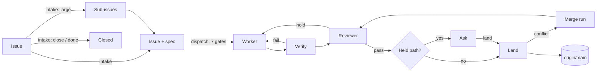

# Workflow

This page follows one change from an issue to a commit on `main`. It names each point where the factory can hold the change, send it back, retry it, rescue it, split it or ask Chris. The code is in `jobs/lib/`. [Factory](factory.md) has the commands and settings. [Routing](routing.md) has the model for each step.

## The path

| Step | Code | Starts on |
|---|---|---|
| Intake | `intake.ts` `intakeIssue`, `factory.ts` `intakeNow` | An issue write (`add`, an answering `note`, `decide`), a dispatch, an issue with `plan` |
| Dispatch | `factory.ts` `runDispatch` → `dispatchIssues` | The end of each run, an issue write, `resume`, a director decision, the sweep |
| Unit (worker, verify, review) | `unit.ts` `unit`, `worker-verdict.ts` | A dispatch that starts an issue (`transitions.ts` `startJob`) |
| Next step | `continuation.ts` `nextStep` | The end of each unit: a fix round, a land or a wait |
| Land | `landing.ts` `land` | A passed run, a dispatch, `aleph land` |
| Director | `director.ts` `direct` | Each write that sets an Ask |
| Rescue | `rescue.ts` `rescueJob` | Each dispatch, for returned, failed, killed and lost runs |
| Tick | `tick.ts` | The `aleph-tick` timer, each minute |

No transition waits for the tick. Each step starts the next one directly. The tick runs periodic work and the sweep, which is the safety net: work it sees two ticks in a row is a missed key, and the sweep starts a dispatch for it.

## Stages of an issue

`stage.ts` gives each issue one stage, tested in this order:

| Stage | When |
|---|---|
| dropped | The store says dropped |
| waiting | The issue, one of its runs or one of its sub-issues has an Ask |
| done | A commit on main names it in an `Issue:` trailer, or the store says done |
| parked | The store says parked |
| failed | Its job or a sub-issue's job is returned or failed |
| working | It has sub-issues in progress |
| landing, working | It has an open job |
| held | It waits on an issue in its `after` list |
| working | `plan` is set: intake will split it |
| queued | It has a spec and waits for a dispatch |
| new | Intake has not taken it in |

A run has one condition: `running`, `waiting`, `passed`, `returned`, `failed`, `landed`, `dropped` or `done`. `returned` is a run that a reviewer or a check sent back to its worker. `record.ts` keeps it, with the run's `next` step.

## 1. Intake

Code decides first, with no agent run (`byCode`):

- An issue of kind `flake` becomes a note on the repo's flake tracker.
- An issue that a commit on main names in an `Issue:` trailer is done.

Otherwise one read-only Opus run on a clone of `origin/main` returns one route:

| Route | Result |
|---|---|
| `build` | A spec (Goal, Edit surface, Oracle), or 2 to 6 sub-issues, each with its own spec and `after` order |
| `close` | Done, with the reason: a duplicate, stale or already fixed |
| `done` | Done; the named commit must be on main |
| `ask` | An Ask with a question, 2 to 4 options and a recommendation |

**Gate: the spec check** (`intake.ts` `problems`). Code checks each spec for:

- no empty section and no placeholder (`???`, `TBD`, `<name>`);
- each Edit surface path on main or marked new;
- an Oracle that names a command or a test file, with no `bun test` argument that bun reads as a name filter;
- each test file the Oracle names on main or in the Edit surface;
- 2 to 6 sub-issues, sub-issue titles within the title rule, and `after` refs that exist;
- for `done`, a commit that is on main.

**Send-backs at intake:**

- A failed spec check goes back to the same session once, with the problems. A second failure sets an `intake-failed` Ask.
- A run with no reply retries at once. After `ALEPH_INTAKE_TRIES` (2), it sets an `intake-failed` Ask, or applies the Always rule (`retry` or `close`).
- A `close` or `done` route on a `red-main` issue while main is still red becomes a `question` Ask.
- A worker follow-up whose Edit surface is only test files closes as a test-only follow-up.

## 2. Dispatch and its gates

Each dispatch first does its steps, in this order:

1. start the next steps that a pause kept (`startKept`);
2. rescue returned, failed, killed and lost runs (`rescueStuck`);
3. land the passed runs;
4. close parents whose sub-issues are done (`closeIssues`);
5. send `plan` issues to intake to split.

Then it asks each queued issue 7 gates, in order (`issue-decision.ts`, `factory-status.ts`). The first gate that binds skips the issue for this dispatch and adds a `hold` event, naming the gate, to the issue's job record in `~/.aleph/jobs/`. The next dispatch asks again.

| Gate | Binds when | Result |
|---|---|---|
| Pause | `~/.aleph/factory/paused` exists | Nothing starts. Intake, director, suite, firefighter, maintainer and episodes stop too. A unit's next step is kept in `paused-next` |
| Backend | The factory holds a backend after a call on it ended with the API credit error (`holdBackend`), until a probe of that backend succeeds (`probeHold`), and the run this issue would start is on it (`viaOfRun`) | Skip. Jobs on that backend do not start; jobs on other backends do |
| Baseline | The last `aleph suite` on main failed | Skip. Issues labelled `red-main` pass, so the fix can land |
| Not ready | The issue is done, waits on `after`, or has an open job | Skip |
| Live cap | `ALEPH_LIVE_CAP` Claude runs are live; local-model runs count against `LOCAL_CAP` (1) | Skip, or route the issue to a tier with room |
| Busy file | A file in the Edit surface had 3 land conflicts in 7 days and another open job names it | Skip |
| Loop guard | The issue's last 3 runs made no commit, or it started too often in 60 minutes: 3 times, or the run cap that `ALEPH_RUN_CAP` or `caps.json` sets | A `no-commit` or `run-cap` Ask in place of a start |

Between Busy file and Loop guard a goal whose last build run ended with the API credit error (`API Error: 402`) less than 10 minutes ago (`waitMs` of `POLICY` in `jobs/lib/records/outcome.ts`) is skipped with a `credit-wait` hold. The credit wait is not one of the 7 gates in `GATES`, because the goal's own last run decides it.

An issue that no gate holds starts. Each start holds the lock `goal-<name>`, so two dispatches start it once. GitHub CI on main does not gate.

**Load admission** (`ledger.ts` `admit`) is not a gate. A check, a worker and a land start only while the 1-minute load average is under `ALEPH_LOAD_LIMIT`. Otherwise they wait in a queue. The wait fails nothing and counts against no time limit.

## 3. The worker

The worker is `claude -p` in `<repo>/.worktrees/job-<name>` on the branch `factory/<name>`, made from `origin/main`. It cannot push to GitHub, and `gh` has no token. It ends with structured output (`WORKER_SCHEMA` in `gate.ts`):

| Field | Becomes |
|---|---|
| `summary` | The run's `result.md` |
| `followups[]` | New parked issues with `source: worker` |
| `flakes[]` | Notes on the flake tracker |
| `defaults[]` | Lines in the report |
| `already_met` | A claim that the issue holds on main; the baseline decides it |
| `question` | A question on the Oracle; with no commit, the issue waits for a spec edit |

**Gate: the worker's output** (`unit.ts` `factoryVerdict`). The run fails when:

- the last event is not a `result` with structured output;
- it made no commit ahead of main, or changed only `result.md`;
- it reached the time box (`ALEPH_JOB_TIMEOUT`, 1800 s);
- its output did not grow for `ALEPH_STALL_SECONDS` (600 s).

A failed run goes to the rescue (section 7).

## 4. Verify

Verify runs four checks in order, each in a detached worktree at the branch's tip. The first failure stops it.

| Check | Code | Passes when |
|---|---|---|
| Repo checks | `checks.ts` `runAll`, `related.ts` `buildChecks` | The setup and the test files the change reaches pass, and every check that is not a test (such as `tsc`). "ran 0 tests" fails |
| Doc claims | `hooks/lib/docclaims.ts` | Each claim in the final message that a doc matches the code has a run, value or `file:line` behind it in the transcript |
| Keep-gate | `checks.ts` `keepGate`, `keep-earn.ts` | Each new test fails on the base and passes on the head; a test that cannot load on the base earns its place by coverage or a mutant; a case named `guard: ...` is skipped, and the reviewer judges it |
| Oracle | `unit.ts` `oracleFailure` | Each Oracle command that the checks did not run passes |

A failing check or Oracle command runs once more on the same tree. A pass on the rerun is a flake, recorded in `~/.aleph/factory/flaky.json`.

**Send-back: the fix round.** A failure sends the job back to its worker on the same branch and worktree. The note names the check and quotes the JUnit failures, or the last 80 lines of the log. A job gets at most `ALEPH_FIX_ROUNDS` (2) rounds. A run that goes back is `returned`. After the last round the run fails as `<check> failed after <n> fix rounds`.

When the same tests fail on two rounds in a row, no further round starts. The run sets a `question` Ask and quotes the failure, so Chris can tell a wrong test from a wrong branch.

**No verdict.** A check that a clock (`ALEPH_CHECK_TIMEOUT`, 1200 s) or a signal ended, or whose setup failed, is neither a pass nor a failure. The run fails with the cause `infra`. This does not use a fix round. The rescue checks the branch again once.

## 5. Review

A fresh reviewer (Opus, read-only, in a detached worktree at the branch's tip) reads the issue, the spec and the diff, and ends with `pass` or `hold <reason>`.

The reviewer also gets these as findings:

- each change that deletes or renames a test, changes a `test`, `it`, `describe` or `expect` line, or adds `.skip`, `.only` or `.todo`;
- each changed file that the Edit surface does not name.

It holds only when the issue does not call for the change.

| Outcome | Result |
|---|---|
| `pass` | Go to the held-path check |
| `hold` | A fix round, like a failed check. After the last round, a `review` Ask |
| No verdict, error or time box (`ALEPH_REVIEW_TIMEOUT`, 600 s) | The reviewer runs once more. A second miss sets a `review` Ask |

A diff over `ALEPH_REVIEW_DIFF_MAX` (200,000 characters) goes in as the `--stat` plus the cut diff. A merge run gets a review of its merge commit only.

**Gate: held paths** (`gate.ts` `heldRule`, `securityChange`). After a pass, a change to a path in the repo's `held` globs or in `SECURITY_PATHS` (tests excepted) waits as a `held-path` Ask. The director can land a held path. Only a security path or `bun.lock` must wait for Chris.

## 6. Land

Lands of one repo go one at a time, in the order they became ready (`landing.ts`).

1. Merge the branch onto `origin/main` in memory (`git merge-tree`). On a conflict, try a mechanical rebase.
2. Refuse a change to the repo's own to-do list (cause `other`): the worker gets it back with a note.
3. Run the land checks: the test files the change reaches, the repo's `critical` globs, and every check that is not a test. A change to a file that is not a module runs every test. When `origin/main` has not moved since the run's checks, only the critical tests run.
4. Push one squash commit with the trailers `Issue: <repo>-<n>` and `Job: <job>`, and `Held-by:` for a held land.
5. Fast-forward the repo's main checkout if it is clean. Restart `aleph-ui` when the change touches a file the server imports.

**Batch.** The land that takes the lock also takes up to `ALEPH_LAND_BATCH` (8) passed runs queued behind it. It checks the last commit once and pushes all of them. On a failure it splits the batch in half until it finds the run that fails.

**Send-backs at the land:**

| Failure | Result |
|---|---|
| Conflict | A merge run: a Haiku worker merges `origin/main` into the branch (600 s), and the reviewer judges the merge commit. At most 2 conflicted lands per job; then the rescue |
| A change to the to-do list | Back to the worker with a note |
| Push lost a race (`moved`) | Land again, at most 3 times |
| Land checks fail | Rescue `land-checks`: drop and rerun the issue once from main |
| No verdict | No batch split; each run lands again once |

The land does not run the full suite. `aleph suite` runs it on `origin/main` each hour and sets the baseline.

## 7. Rescue

The rescue (`rescue.ts`, `continuation.ts` `rescueCase`) takes one safe action per case, once per issue. The second time on the same issue sets a `rescue` Ask.

| Case | Action |
|---|---|
| Killed by a host restart | A land lands again; a run with commits ahead of main is checked again; else drop and rerun. Does not use the once-per-issue mark |
| Lost (the process ended with no end record) | The same actions, once per issue |
| A spec question | A `question` Ask; the run waits for a spec edit and drops when the spec changes |
| Duplicate: no commit, and the issue is already done | Drop and close |
| `already_met` | The baseline decides: green is done; red reruns with a note; unchecked waits |
| No commit | Drop and rerun |
| `infra` | Check again, land again, or drop and rerun when there is no branch |
| Time box | Drop and set `plan`, so intake splits the issue. Ask instead when the issue is a sub-issue, was split before or hit the time box before |
| Land conflict after 2 bounces, land checks failed | Drop and rerun once from main |
| Stalled, failed after the fix rounds, other | A `rescue` Ask |

`aleph recheck <name>` is the manual way out that keeps the work. It merges the current `origin/main` into the branch, runs the checks, the held rule and the reviewer with no fix rounds, and lands like any passed run.

## 8. Asks, the director and Always rules

Whatever waits for Chris is an Ask (`ask.ts`), with a reason, a question and options.

| Reason | Kind | Actions | Always action |
|---|---|---|---|
| `held-path` | approval | land, drop | none |
| `review` | approval | land, drop | none |
| `question` | input | answer, drop, decide, deny | `recommended` (intake's own Asks only) |
| `no-commit` | input | rerun, close | none |
| `part-dropped` | input | rerun, close | none |
| `intake-failed` | input | retry, close | `retry` |
| `rescue` | input | decide, drop | `recommended` |
| `run-cap` | input | rerun, close | none |
| `core-change` | approval | approve, decline | none |
| `proposal-check`, `proposal-claude-md`, `proposal-skill` | approval | approve, decline | `approve` |

**The director.** Every new Ask goes to the director first. It is one read-only Fable run per Ask (`director.ts`), under the lock `director-<on>`, at most `ALEPH_DIRECTOR_CAP` (3) per call. It returns actions: `land`, `drop`, `answer`, `rerun`, `close`, `drop-issue`, `edit-goal`, `add` or `note`, at most 10. Code checks and applies each one. Code refuses:

- closing or dropping an issue Chris filed;
- landing a branch that changes a security path or `bun.lock`;
- landing a held run before the reviewer gave a verdict;
- answering an Ask whose run waits for a spec edit.

**Escalation** (`director.ts` `escalation`). The director writes case text (situation, effects, recommendation) and takes no action when:

- the Ask is a memory proposal;
- it is a `core-change` Ask: the memory re-check holds a correct or archive verdict on a core note, on a parked issue. Approve applies the verdict through the vault op and closes the issue as done, or notes the op's refusal on the issue. Decline keeps the claim, sets the note's `updated` to today and drops the issue;
- it is a second `run-cap` or `rescue` Ask on an issue the director decided once;
- the land changes a security path or `bun.lock`;
- a held run's branch cannot be read.

An Ask that the actions leave open, a failed director run or a malformed reply also escalates. The Status page shows an Ask's buttons only after the director escalates it.

**Always rules.** The Always button and `aleph always grant` write a rule to `~/.aleph/factory/always.json` that maps a reason to an action. Only the reasons with an Always action in the table above use it. The next Ask with that reason takes the action without Chris.

**No-answer timeouts.** `aleph always timeout <reason> <minutes> [pick|drop]` and the Gates page set, for any reason in the table above but the memory proposals, minutes and a no-answer action in `~/.aleph/factory/timeouts.json`; 0 removes them. When Chris does not answer an escalated Ask of that reason in time, on a waiting run or on an issue, the tick takes the action once. `pick` takes the action the director's case text recommends, and keeps waiting when it recommends none; `drop` takes the reason's drop, close or deny. A land takes `Held-by: timeout` and includes the escalation list. A reason with no timeout keeps waiting. The Ask card shows the time of the land.

## 9. Human controls

| To | CLI | UI |
|---|---|---|
| Stop and restart new work | `aleph pause`, `aleph resume` | Pause button |
| Land a passed, held or reviewed run | `aleph land <name>` | Land it |
| Drop a run and its branch | `aleph drop <name> [reason]` | Drop the job |
| Check a returned or failed run again, keeping its work | `aleph recheck <name>` | Recheck |
| Answer an issue that waits | `aleph issue decide <repo> <id> "<text>"` or `note` | Decide, Note |
| Change an issue's spec | `aleph issue edit <repo> <id> --spec -` | Edit |
| Grant or revoke a standing rule | `aleph always grant\|revoke` | Always, Gates page |
| Set a no-answer timeout | `aleph always timeout <reason> <minutes> [pick\|drop]` | Gates page |
| Set caps and models | `aleph models`, `~/.aleph/factory/caps.json` | Gates page, Agents page |

A write to an issue starts intake or a dispatch at once. A land by hand writes `Held-by:` with the lander's name.

## Background tasks

| Task | Trigger | Does | Stops duplicate work |
|---|---|---|---|
| Firefighter | Tick, each 5 minutes | Files one `critical` `red-main` bug per failing commit of the baseline or GitHub CI; sets a `rescue` Ask on a land live for 30 minutes | The `Failing commit:` line; an `asked` event on the land's record |
| Suite | `aleph-suite` timer, hourly; the sweep after a red main moves | Runs the full checks on `origin/main` and records the baseline | Runs only when main moved |
| Maintainer | Tick, daily from 03:00; `aleph memory maintain [--dry]` | Runs the mechanical vault pass, groups signals into lessons and proposes a check, a rule or a skill as a `proposal-*` Ask, and compiles yesterday into vault notes | Signals already in a lesson are skipped; the vault run record and `compiledDays` |
| Episodes | Tick, each 30 minutes | Writes a page for each finished issue | `episodes-seen` |
| Monitor | Tick, daily | Reads the day's records and writes numbered findings for the Status page | One per day |

## Where to look

| To learn | Read |
|---|---|
| Why an issue did not start | The `hold` events in `~/.aleph/jobs/<repo>-<n>.json`, or the Holds panel on Status |
| Why a run stopped | `aleph status <repo>-<n>`, or the job page |
| What a check printed | `~/.aleph/runs/<run>/checks.log` |
| What the director decided | The Automation page |
| What the sweep caught | the event log, events with the action `missed` |
